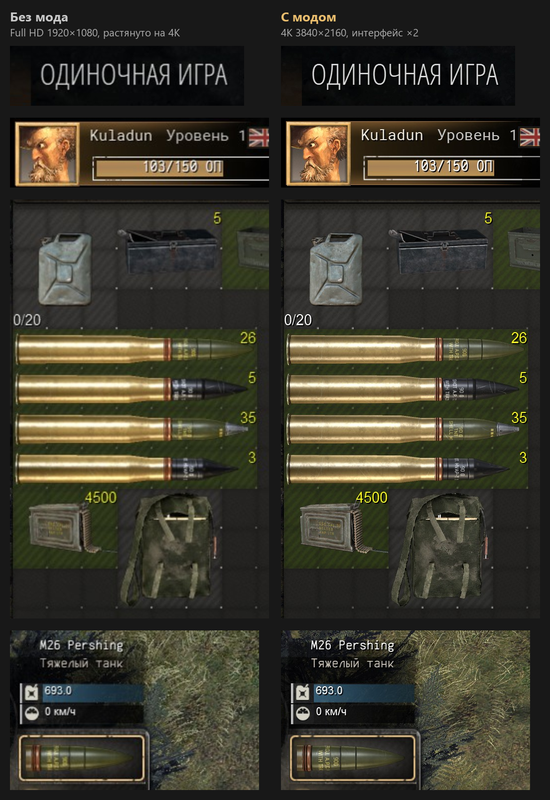
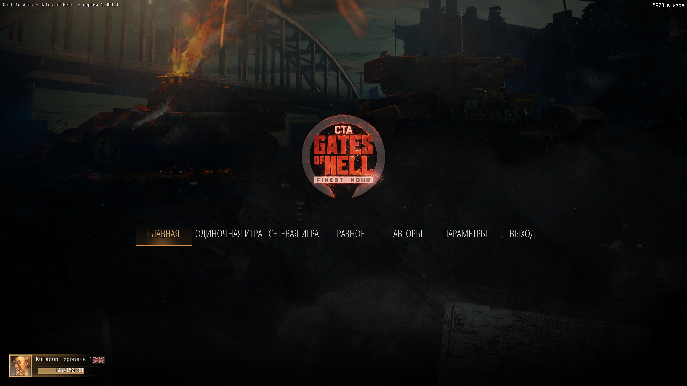
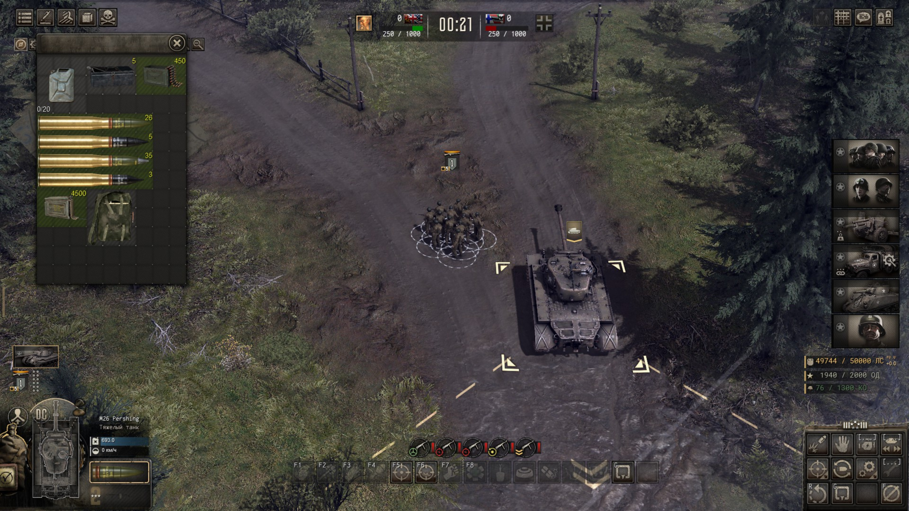
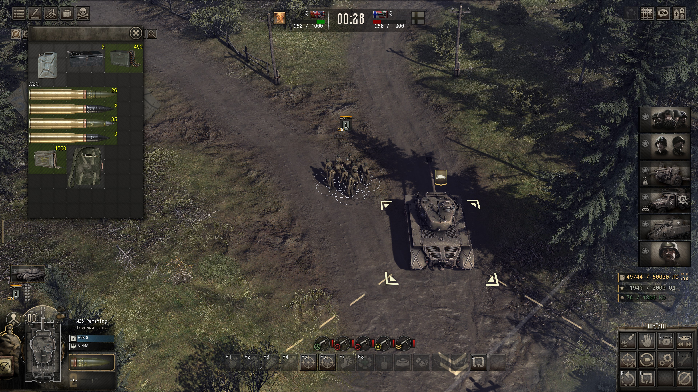
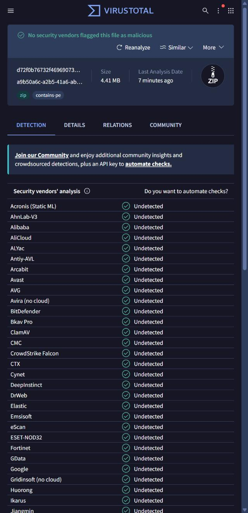
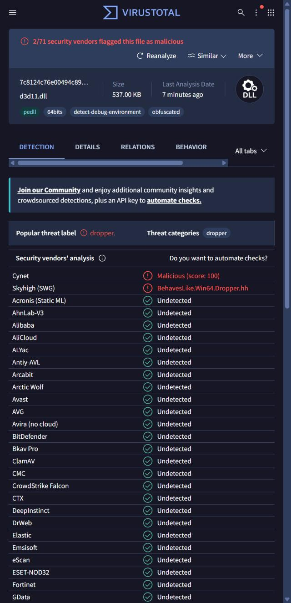

# Call to Arms Gates of hell - 4K UI Fix (AI)

**Крупный и чёткий интерфейс для Call to Arms – Gates of Hell: Ostfront на мониторах 2K, 4K и 21:9.**
**A large, sharp interface for Call to Arms – Gates of Hell: Ostfront on 2K, 4K and 21:9 monitors.**

### ⬇ [Скачать 2.0 / Download 2.0](../../releases/tag/v2.0)

[Как это выглядит / How it looks](#как-это-выглядит--how-it-looks) · [Все версии / All releases](../../releases) · [Что изменилось / Changelog](CHANGELOG.md) · [Проверка на вирусы / Virus scan](#проверка-на-вирусы--virus-scan) · [Nexus Mods](https://www.nexusmods.com/calltoarmsgatesofhellostfront/mods/29) · [Steam guide](https://steamcommunity.com/sharedfiles/filedetails/?id=3839336153)

**[Русский](#русский) · [English](#english)**

> Мод и инструменты созданы с помощью ИИ (Claude) — отсюда «(AI)» в названии.
> The mod and its tools were built with AI assistance (Claude) — hence "(AI)" in the name.

---

## Как это выглядит / How it looks

Слева — без мода: игра в Full HD 1920×1080, растянутая на монитор 4K. Справа — с модом: 4K 3840×2160, интерфейс ×2. Фрагменты в масштабе 1:1.
Left: without the mod — the game at Full HD 1920×1080, stretched to a 4K monitor. Right: with the mod — 4K 3840×2160, interface ×2. Close-ups at 1:1.



Полные снимки экрана 3840×2160 — нажмите на картинку, чтобы открыть её в полном размере.
Full 3840×2160 screenshots — click a picture to open it at full size.

**Меню без мода / Menu without the mod** — Full HD, растянуто на 4K / stretched to 4K


**Меню с модом / Menu with the mod** — 4K, интерфейс ×2 / interface ×2


**Бой без мода / Battle without the mod** — Full HD, растянуто на 4K / stretched to 4K


**Бой с модом / Battle with the mod** — 4K, интерфейс ×2 / interface ×2


---

## Русский

### Возможности
| | |
|---|---|
| **Любой монитор** | 2K, 4K, широкоформатные 21:9. Два монитора — тоже. |
| **Масштаб на выбор** | ×1, ×1.25, ×1.5, ×1.75, ×2 и «интерфейс как на Full HD». |
| **Мир отдельно от интерфейса** | 3D — в родном разрешении монитора или меньше (1440, 1080): больше кадров, а интерфейс остаётся чётким. |
| **Чёткий текст** | Буквы интерфейса рисуются в высоком разрешении, а не растягиваются. |
| **Чёткие иконки предметов** | Только иконки предметов в инвентаре (оружие, боеприпасы, снаряжение) — их игра рисует из 3D-моделей. Остальные картинки интерфейса (карточки отрядов, кнопки, значки) увеличены как есть. |
| **Всё в самой игре** | Выбор — в списке разрешений игры, сменить можно на ходу. |
| **Эффекты игры** | MSAA, HDR, глубина резкости, затенение HBAO+ работают вместе с модом. |
| **Без вмешательства в игру** | Файлы игры и exe не меняются, в архиве нет программ. |

### Установка
1. Скачайте архив из [выпуска 2.0](../../releases/tag/v2.0) и распакуйте.
2. Закройте игру. Откройте её папку: Steam → правой кнопкой по игре → Управление → Просмотреть локальные файлы.
3. Перетащите туда папку `binaries` из архива. Файлы `d3d11.dll`, `ui4k.ini`, `ui4k_fonts2.dat` и `ui4k_fonts4.dat` окажутся в `binaries\x64`, рядом с `call_to_arms.exe`.

### Как пользоваться
«Параметры» → «Видео» → «Разрешение». В списке — строки мода:

```
2560×1440  ×2
```
- первое — разрешение 3D-мира, «×2» — во сколько раз увеличен интерфейс;
- строка с разрешением монитора и «×1» — игра как без мода;
- «интерфейс как на Full HD» — интерфейс того же размера, что на мониторе 1920×1080;
- «другой монитор» — переносит игру на второй монитор.

Выберите строку и нажмите «Применить». Окна, 3D-виды и иконки предметов перерисуются в новом масштабе сами.

### Настройки
Файл `ui4k.ini` в `binaries\x64`, описание каждой настройки — внутри. Обычно менять ничего не нужно.
- `enabled=0` — выключить мод, не удаляя его;
- `fonts=0` — обычные буквы игры вместо чётких.

### Обновление и удаление
- **Обновление:** закройте игру и перетащите папку `binaries` из нового архива с заменой файлов. С 1.0 папку `ui4k_fonts` можно удалить.
- **Удаление:** закройте игру и удалите из `binaries\x64` файлы `d3d11.dll`, `ui4k.ini`, `ui4k_fonts2.dat`, `ui4k_fonts4.dat`, `ui4k_labels.pak` и `ui4k.log`. Разрешение игра вернёт сама.

### Если что-то не так
Пришлите `ui4k.log` из `binaries\x64` и напишите, что делали, какая видеокарта и монитор. Проверено на NVIDIA; на AMD и Intel мод должен работать, но там его ещё не проверяли.

### Сетевая игра
Мод не трогает exe и файлы, которые игра сверяет по сети, — только то, как картинка выводится на экран. Официально это не проверялось, на ваше усмотрение.

### История версий
**2.0 — 20.11.2026**
- Чёткий текст интерфейса и чёткие иконки предметов в инвентаре.
- Линии интерфейса (рамка на миникарте) толщиной в логический пиксель.
- Смена масштаба на ходу: окна, 3D-виды и иконки предметов перерисовываются без перезапуска.
- Запуск сразу в масштабе из настроек игры.
- Исправлено: мигание мира при беге в прямом управлении, свет и туман над отдельными местами карты, мигание затенения HBAO+, отражение в воде, падение FPS в меню паузы, помехи от счётчика RivaTuner и других оверлеев, лишние строки на мониторах 1080p и 1440p, снимок экрана Steam (F12).

**2.0 beta — 17.11.2026**
- Мод написан заново: любой монитор (2K, 4K, 21:9), масштаб ×1…×2 и «как на Full HD».
- 3D-мир отдельно от интерфейса, всё выбирается в самой игре, подписи строк на русском и английском.
- Два монитора, MSAA; яркость, глубина резкости и HBAO+ — как у игры.
- Мод сам находит нужные шейдеры в архиве игры, поэтому её обновления чаще всего его не ломают.

**1.0 — 14.11.2026**
- Первая версия: только 4K, интерфейс ровно ×2 при игре в 1920×1080, 3D в 3840×2160.

Подробно — [CHANGELOG.md](CHANGELOG.md).

### Сборка из исходников
Нужен Python 3.11+ и `pip install ziglang` (компилятор C ставить не нужно).
```
python build.py             # DLL -> out\d3d11.dll
python build.py --test      # тесты без игры
python build.py --package   # архив для игроков -> out\package
python build.py --install   # поставить в игру (игра должна быть закрыта)
```
Папка игры ищется через Steam; иначе задайте `GOH_DIR=<папка игры>`. Для `--package` положите файлы `ui4k_fonts2.dat` и `ui4k_fonts4.dat` из архива выпуска в `out\fontpages\`.
Как всё устроено — [docs/ARCHITECTURE_RU.md](docs/ARCHITECTURE_RU.md).

---

## English

### Features
| | |
|---|---|
| **Any monitor** | 2K, 4K, 21:9 ultrawide. Two monitors as well. |
| **Scale of your choice** | ×1, ×1.25, ×1.5, ×1.75, ×2 and "UI like Full HD". |
| **World apart from the interface** | 3D at the monitor's native resolution or lower (1440, 1080): more frames, the interface stays sharp. |
| **Sharp text** | Interface letters are drawn at high resolution instead of being stretched. |
| **Sharp item icons** | Only the item icons in the inventory (weapons, ammo, equipment) — the game draws them from 3D models. Other interface images (unit cards, buttons, markers) are enlarged as they are. |
| **All in the game** | Picked in the game's resolution list, can be changed on the fly. |
| **Game effects** | MSAA, HDR, depth of field and HBAO+ shading work together with the mod. |
| **Hands off the game** | Game files and the exe are not changed, the archive has no programs. |

### Installing
1. Download the archive from the [2.0 release](../../releases/tag/v2.0) and unpack it.
2. Close the game. Open its folder: Steam → right-click the game → Manage → Browse local files.
3. Drag the `binaries` folder from the archive into it. `d3d11.dll`, `ui4k.ini`, `ui4k_fonts2.dat` and `ui4k_fonts4.dat` end up in `binaries\x64`, next to `call_to_arms.exe`.

### Using it
Options → Video → Resolution. The list has the mod's entries:

```
2560×1440  ×2
```
- the first part is the 3D world's resolution, "×2" is how many times the interface is enlarged;
- the entry with the monitor's resolution and "×1" is the game as without the mod;
- "UI like Full HD" — an interface of the same size as on a 1920×1080 monitor;
- "other monitor" — moves the game to the second monitor.

Pick an entry and press Apply. Windows, 3D views and item icons are redrawn at the new scale by themselves.

### Settings
The file `ui4k.ini` in `binaries\x64` describes every setting. Usually nothing needs changing.
- `enabled=0` — turn the mod off without removing it;
- `fonts=0` — the game's usual letters instead of the sharp ones.

### Updating and removing
- **Updating:** close the game and drag the `binaries` folder from the new archive in, replacing the files. Coming from 1.0, the `ui4k_fonts` folder can be deleted.
- **Removing:** close the game and delete `d3d11.dll`, `ui4k.ini`, `ui4k_fonts2.dat`, `ui4k_fonts4.dat`, `ui4k_labels.pak` and `ui4k.log` from `binaries\x64`. The game sets its resolution back by itself.

### If something goes wrong
Send `ui4k.log` from `binaries\x64` and say what you did, your graphics card and monitor. Tested on NVIDIA; it should work on AMD and Intel, but it has not been tested there yet.

### Multiplayer
The mod does not touch the exe or the files the game checks online — only how the picture is put on the screen. This has not been officially verified, use at your discretion.

### Version history
**2.0 — 2026-11-20**
- Sharp interface text and sharp item icons in the inventory.
- Interface lines (the minimap frame) one logical pixel thick.
- Scale changes on the fly: windows, 3D views and item icons are redrawn without a restart.
- Starts right away at the scale from the game settings.
- Fixed: the world flashing during a sprint in direct control, lighting and fog over some spots of the map, HBAO+ flashing, water reflection, FPS drop in the pause menu, interference from the RivaTuner counter and other overlays, extra entries on 1080p and 1440p monitors, the Steam screenshot (F12).

**2.0 beta — 2026-11-17**
- Rewritten from scratch: any monitor (2K, 4K, 21:9), scale ×1…×2 and "as on Full HD".
- 3D world apart from the interface, everything picked in the game itself, entry labels in Russian and English.
- Two monitors, MSAA; brightness, depth of field and HBAO+ as the game's own.
- The mod finds the shaders it needs in the game's archive, so game updates rarely break it.

**1.0 — 2026-11-14**
- First version: 4K only, interface exactly ×2 with the game at 1920×1080, 3D at 3840×2160.

Details: [CHANGELOG.md](CHANGELOG.md).

### Building from source
Python 3.11+ and `pip install ziglang` (no C compiler needed).
```
python build.py             # DLL -> out\d3d11.dll
python build.py --test      # tests without the game
python build.py --package   # player archive -> out\package
python build.py --install   # install into the game (the game must be closed)
```
The game folder is found through Steam; otherwise set `GOH_DIR=<game folder>`. For `--package`, copy `ui4k_fonts2.dat` and `ui4k_fonts4.dat` from the release archive into `out\fontpages\`.
How it works: [docs/ARCHITECTURE_RU.md](docs/ARCHITECTURE_RU.md) (in Russian).

---

## Проверка на вирусы / Virus scan

**Проверено 20.11.2026 на VirusTotal / Checked on 2026-11-20 on VirusTotal**

| Файл / File | SHA-256 | VirusTotal |
|---|---|---|
| `GoH-UI4K-2.0-2026.11.20-491f4a9.zip` (release) | `d72f0b76732f46969073000570620e7e06fd72e7360817afae90183e438be92d` | [**0 / 55** — clean](https://www.virustotal.com/gui/file/d72f0b76732f46969073000570620e7e06fd72e7360817afae90183e438be92d) |
| `d3d11.dll` (inside the zip) | `7c8124c76e00494c8960b21f88fa55387e9677a0fee90fd36895363a09c5be28` | [**2 / 71**](https://www.virustotal.com/gui/file/7c8124c76e00494c8960b21f88fa55387e9677a0fee90fd36895363a09c5be28) — see below / см. ниже |

Единственный исполняемый файл мода — `d3d11.dll`; `ui4k.ini` и `README_*.txt` — текст, `ui4k_fonts*.dat` — данные изображений.
The only executable file of the mod is `d3d11.dll`; `ui4k.ini` and `README_*.txt` are text, `ui4k_fonts*.dat` are image data.

### Что произошло с DLL / What happened with the DLL
**Русский.** Два антивируса из 71 отметили `d3d11.dll`, оба — без названия какого-либо вируса:
- **Cynet** — «Malicious (score: 100)»: оценка машинного обучения;
- **Skyhigh (SWG)** — «BehavesLike.Win64.Dropper.hh»: догадка по поведению («ведёт себя похоже на…»).

Почему так: мод — это прокси `d3d11.dll`. Игра загружает его из своей папки, он передаёт все вызовы системной `d3d11.dll` и по пути перехватывает вызовы Direct3D и окна игры, чтобы увеличить интерфейс. Для автоматических эвристик такое поведение похоже на подозрительное. Мод при этом ничего не скачивает, не создаёт и не запускает других программ, не работает с сетью и не меняет файлы игры; его исходный код открыт в этом репозитории.

Остальные **69 из 71** антивирусов — чисто, в том числе Microsoft Defender, Kaspersky, ESET-NOD32, BitDefender, Avast и Malwarebytes. Архив выпуска целиком — **0 из 55**.

**Что мы делаем:** отправляем в Cynet и Skyhigh заявки о ложном срабатывании (адреса — из официального списка VirusTotal). После их пересмотра обновим этот раздел.

**English.** Two of 71 engines flagged `d3d11.dll`, both without naming any malware:
- **Cynet** — "Malicious (score: 100)": a machine-learning score;
- **Skyhigh (SWG)** — "BehavesLike.Win64.Dropper.hh": a behaviour guess ("behaves like…").

Why: the mod is a proxy `d3d11.dll`. The game loads it from its own folder; it forwards every call to the system `d3d11.dll` and hooks Direct3D and the game window on the way to enlarge the interface. Automatic heuristics see that as suspicious. The mod does not download, create or run any other program, has no network code and does not change the game's files; its source code is open in this repository.

The other **69 of 71** engines report it clean, including Microsoft Defender, Kaspersky, ESET-NOD32, BitDefender, Avast and Malwarebytes. The whole release archive: **0 of 55**.

**What we do:** we are sending false-positive reports to Cynet and Skyhigh (addresses from VirusTotal's official list). This section will be updated after their review.

### Подтверждения / Proof
Снимки отчётов VirusTotal на 20.11.2026 / VirusTotal reports as of 2026-11-20:

| Архив выпуска / Release archive — 0 / 55 | `d3d11.dll` — 2 / 71 |
|---|---|
|  |  |

Актуальные отчёты — по ссылкам в таблице выше. / Current reports: links in the table above.

### Проверить свой файл / Check your download
PowerShell:
```
Get-FileHash .\GoH-UI4K-2.0-2026.11.20-491f4a9.zip -Algorithm SHA256
```
Хэш должен совпасть с таблицей выше и с `SHA256SUMS.txt` в выпуске. / The hash must match the table above and `SHA256SUMS.txt` in the release.

---

Unofficial fan mod. The game and its assets belong to Barbedwire Studios / Digitalmindsoft. Mod code license: MIT.
